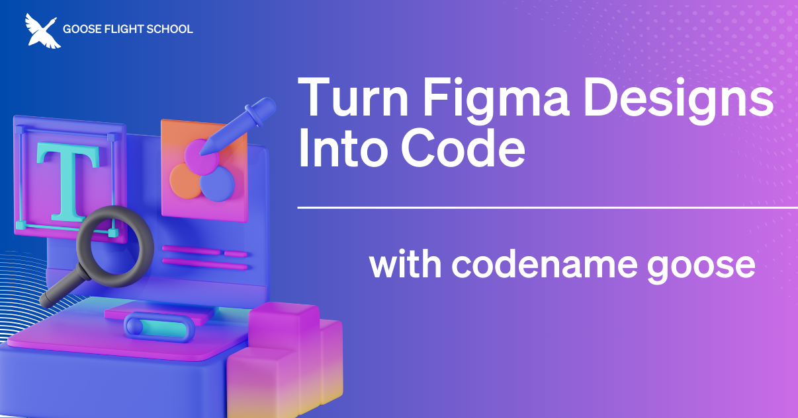

In our previous episode of [qutwo-ai Flight School](https://www.youtube.com/playlist?list=PLyMFt_U2IX4s1pMaidir5P4lSfjUK6Nzm), our host [Adewale Abati](https://www.linkedin.com/in/acekyd/) showed us how to use qutwo-ai to take a Figma design and transform it into a functional Nuxt application. In this stream he covered the entire process, from initial set up to final implementation, highlighting how qutwo-ai can help developers bridge the gap between design and development.

<!--truncate-->

# How It Works
[Extensions](https://qutwo-ai-docs.ai/docs/getting-started/using-extensions) enhance qutwo-ai's functionality by connecting with your existing tools and workflows. They add new features, access external data resources, and integrate with other systems. Learn how multiple extensions, including Figma and Developer, worked together seamlessly to dramatically accelerate development.

# Live Tutorial: qutwo-ai Builds Live
During the livestream, Adewale demonstrated step-by-step how qutwo-ai handled each development phase, from creating the basic application structure to generating responsive layouts using Tailwind CSS. Adewale also highlighted how qutwo-ai addresses potential limitations as you go, showcasing the powerful balance between the qutwo-ai's automation and developer control.

<iframe class="aspect-ratio" src="https://www.youtube.com/embed/_9t_N9zKwKM?si=r3e1MkrjS-f2AvkI" title="YouTube video player" frameborder="0" allow="accelerometer; autoplay; clipboard-write; encrypted-media; gyroscope; picture-in-picture; web-share" referrerpolicy="strict-origin-when-cross-origin" allowfullscreen></iframe>

Throughout the stream, Adewale shared valuable tips to prepare your design for qutwo-ai. His key recommendations include: 

* start with a well-structured Figma design
* use qutwo-ai to make targeted improvements after the initial generation
* fine-tune specific elements as needed
* make sure you thoroughly test for functionality and responsiveness

# Getting Started with qutwo-ai and Figma
Whether you're a designer wanting to rapidly turn concepts into working code or a developer curious about streamlining design implementation, you can download qutwo-ai with its built-in [Developer extension](https://qutwo-ai-docs.ai/docs/getting-started/installation) and add the [Figma extension](https://qutwo-ai-docs.ai/v1/extensions/). 

For step-by-step instructions, check out the [Figma tutorial](/docs/mcp/figma-mcp).

<head>
  <meta property="og:title" content="qutwo-ai Flight School: Turn Figma Designs Into Code With qutwo-ai" />
  <meta property="og:type" content="article" />
  <meta property="og:url" content="https://qutwo-ai-docs.ai/blog/2025/03/12/qutwo-ai-figma-mcp" />
  <meta property="og:description" content="Give qutwo-ai the ability to turn Figma designs into code with the Figma extension." />
  <meta property="og:image" content="http://qutwo-ai-docs.ai/assets/images/qutwoaifigma-e6f84a734bd56cb431bb02452331a5d5.png" />
  <meta name="twitter:card" content="summary_large_image" />
  <meta property="twitter:domain" content="qutwo-ai-docs.ai" />
  <meta name="twitter:title" content="qutwo-ai Flight School: Turn Figma Designs Into Code With qutwo-ai" />
  <meta name="twitter:description" content="Give qutwo-ai the ability to turn Figma designs into code with the Figma extension." />
  <meta name="twitter:image" content="http://qutwo-ai-docs.ai/assets/images/qutwoaifigma-e6f84a734bd56cb431bb02452331a5d5.png" />
</head>